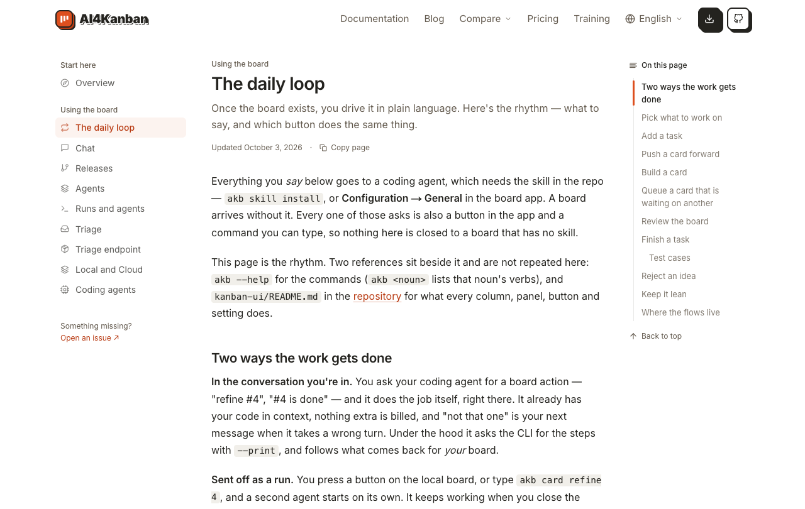
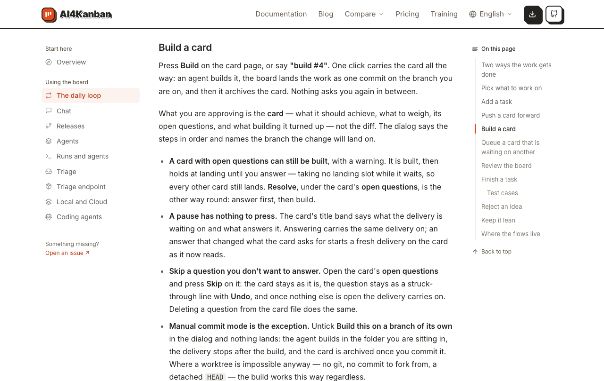
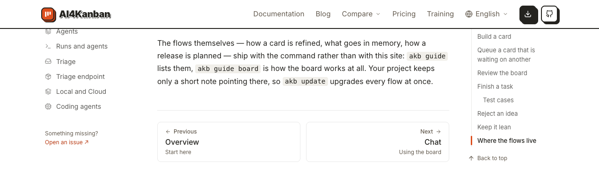
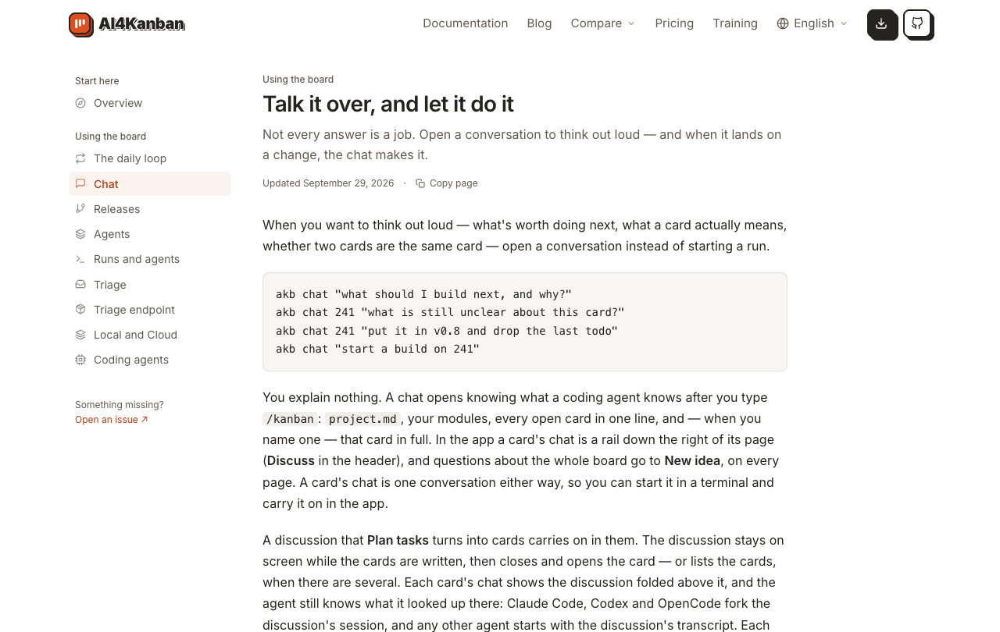

# 从文档首页找到并读完「The daily loop」

## Setup

- **站点**：官网（`web/`）在本地跑起来，浏览器打开 `/docs`，窗口 1280×1000。
- **读者**：刚装好看板、想知道每天怎么用它的新用户。

## Steps

1. 打开 `/docs`。
   左栏三组：「Start here」（Overview、Your first card）、「How it works」（Draft review、Memory、Follow-ups、Workflows）、「Using the board」，「Overview」高亮；正文先是「Install the board」（桌面应用下载和两行安装命令），往下是「Read this first」，里面只有一张「The daily loop」卡片。
   

2. 点「Read this first」里的「The daily loop」。
   进入 `/docs/daily-loop`，标题「The daily loop」；左栏高亮移到「The daily loop」，右侧「On this page」列出 10 个小节加一个子节（「Finish a task」下的「Test cases」），第一项高亮；正文开头一段说要说的话都交给装了 skill 的编程 Agent，每句话也是界面上的按钮和一条命令。
   

3. 点右侧目录里的「Build a card」。
   页面滚到「Build a card」一节，标题停在页头下方；地址栏带 `#build-a-card`，目录里该项高亮。
   

4. 滚到页面底部。
   最后一节是「Keep it lean」；下面是两张翻页卡：左「Previous / Workflows」（分组 How it works），右「Next / Chat」（分组 Using the board）。
   

5. 点「Next / Chat」。
   进入 `/docs/chat`，从页顶开始显示，左栏高亮移到「Chat」。
   

## Feedback

- **首页没指向新手第一站**：左栏「Start here」已有「Your first card」，可首页「Read this first」仍只放「The daily loop」一张卡；刚装好的人照首页点，会跳过从想法走到交付的那篇。
- **三条路都通向同一页**：左栏、正文卡片、页底翻页都能到「The daily loop」。
- **页不长**：滚到底约 4600px，每节几句话加几条要点，不靠目录也读得完。
- **翻页把顺序摆出来了**：「The daily loop」往前是「Workflows」，分组名也不同（How it works / Using the board），翻页卡上的分组名这次有了信息。
- **左栏图标撞了**：「The daily loop」和新加的「Follow-ups」用同一个循环箭头，中间只隔一个 Workflows，找「每天怎么用」的人可能先点错。
- **翻页落点名字不一致**：往后是「Chat」，点进去标题却叫「Talk it over, and let it do it」，第一眼会以为点错了。
- **没有跑到的**：窄屏下的这条路径（见 [在文档页之间跳转](../move-between-docs-pages/case.md) 第 5–7 步）、站内搜索、「Copy page」按钮。
