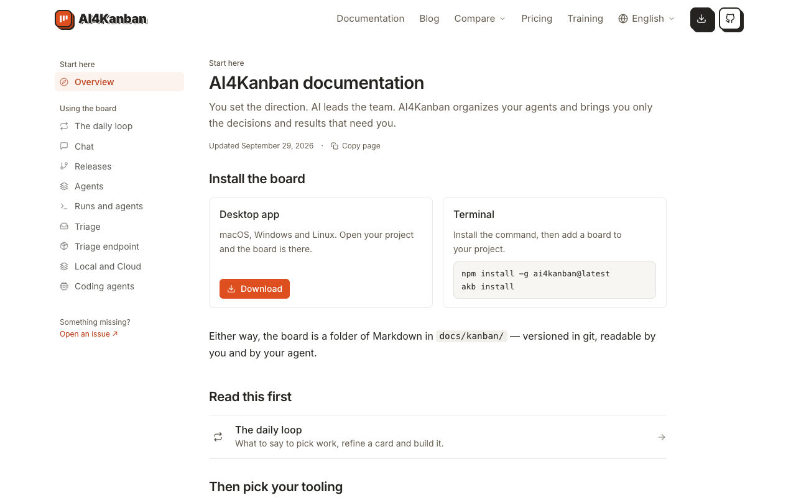

# 从文档首页找到并读完「The daily loop」

## Setup

- **站点**：官网（`web/`）在本地跑起来，浏览器打开 `/docs`，窗口 1280×1000。
- **读者**：刚装好看板、想知道每天怎么用它的新用户。

## Steps

1. 打开 `/docs`。
   标题「AI4Kanban documentation」，导语「An agent workspace for indie hackers…」；左栏三组「Start here」「How it works」「Using the board」，「Overview」高亮；正文七节，从「Install the desktop app」（只有一张「Download AI4Kanban」卡片，没有安装命令）到「Switch between projects」；整页不出现 npm、`akb` 或 `--board`。
   
   [首页与配图](daily-loop.log)

2. 往下读「Deliver your first card」。
   先是「Connect a coding agent」链接和「Your first card」卡片，下面是交付后的 Diff 截图，图下一句「After your first delivery, use the daily loop to pick work…」；首页三张配图（`delivered`、`draft`、`workflow-on-card`）都加载出来。
   

3. 点这句里的「the daily loop」。
   `/docs/daily-loop` 在新标签页打开，首页留在原标签页；新页标题「The daily loop」，左栏高亮移到「The daily loop」，右侧「On this page」列出 10 个小节加一个子节（「Finish a task」下的「Test cases」），第一项高亮。
   
   [标签页前后](03-new-tab.log)

4. 点右侧目录里的「Build a card」。
   页面滚到「Build a card」一节，标题停在页头下方；地址栏带 `#build-a-card`，目录里该项高亮。
   

5. 点目录里的「Queue a card that is waiting on another」。
   标题下先是一张浅蓝紫水彩底上的任务图截图（#311 的五个子任务 #314→#315→#316→#317 / #328 连成一条线，下面是子任务清单），占满正文栏（624px），然后才是讲「被挡住的卡也能构建或细化」的那段。
   

6. 点目录里的「Review the board」。
   标题下是看板截图叠在卡片截图前面的一副「翻页卡」，后面那张从右下角露出一截，然后才是「Say "review the board"…」那段；两张图都加载出来。
   

7. 点后面那张露出的一截。
   卡片截图翻到前面（#38 Sync notes across devices 的详情），看板退到后面；尺寸不变，页面不跳。
   

8. 滚到页面底部。
   最后一节是「Keep it lean」；下面是两张翻页卡：左「Previous / Workflows」（How it works），右「Next / Chat」（Using the board）。
   

9. 点「Next / Chat」。
   进入 `/docs/chat`，从页顶开始显示，左栏高亮移到「Chat」，页标题是「Discuss ideas and update cards」。
   

10. 把窗口换成 390px 宽的手机，重新打开 `/docs/daily-loop`。
    任务图和翻页卡都不显示，两节直接从正文开始，页面没有横向滚动。
    见上面 [首页与配图](daily-loop.log) 末尾的「390px wide」。

## Feedback

- **首页先把新手送去第一张卡**：「Deliver your first card」排在安装之后，「The daily loop」放到交付之后再读，顺序对了。
- **「The daily loop」入口偏弱**：只是配图下面一句里的链接，扫读的人容易错过；左栏仍是最稳的入口。
- **两张图让长页有了落脚点**：任务图正好放在讲「卡被挡住」的地方，一眼看懂依赖；翻页卡能看到看板和卡片两种视图。
- **截图字太小**：栏宽 624px 下看板截图里的卡片标题读不出来，只能看个布局；也没有点开放大。
- **翻页卡不好发现**：后面那张只露出 40px 的一截、没有任何提示，不知道能点；点中间（前面那张）没反应。
- **例子对不上**：正文举的是 #4，任务图是 #311、翻页卡是 #38，读者会以为在说别的卡。
- **手机上整张图都不见**：窄屏只剩文字，读者不知道少了什么；这是有意的，但任务图那节读起来更抽象。
- **正文链接另开标签页**：点「the daily loop」会新开一页，读完首页再回来攒了好几个标签。
- **首页和下一页口径不一**：首页刻意不写命令，点进「The daily loop」第一段就是 `akb skill install`、`akb --help`。
- **翻页落点名字不一致**：往后是「Chat」，点进去标题叫「Discuss ideas and update cards」。
- **没有跑到的**：窄屏下截图（只量了显示与否）、站内搜索、「Copy page」按钮。
