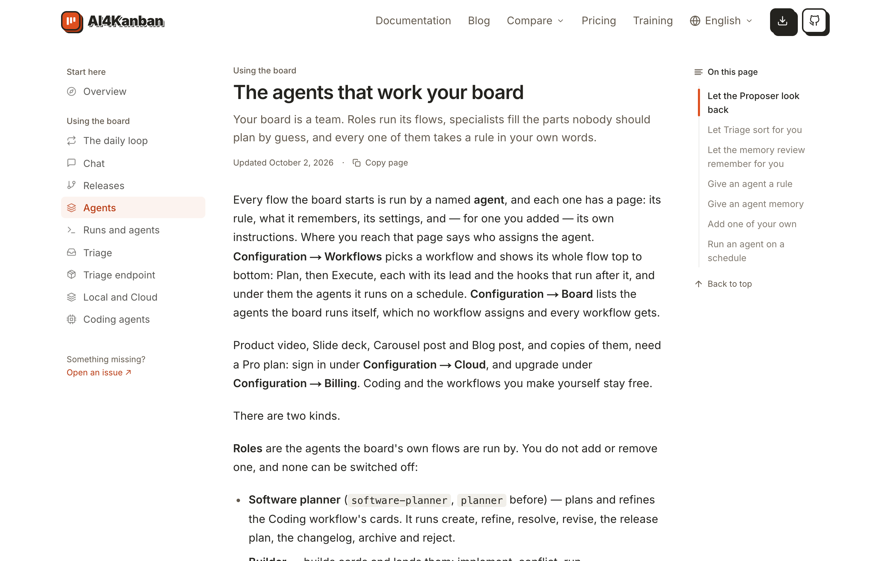
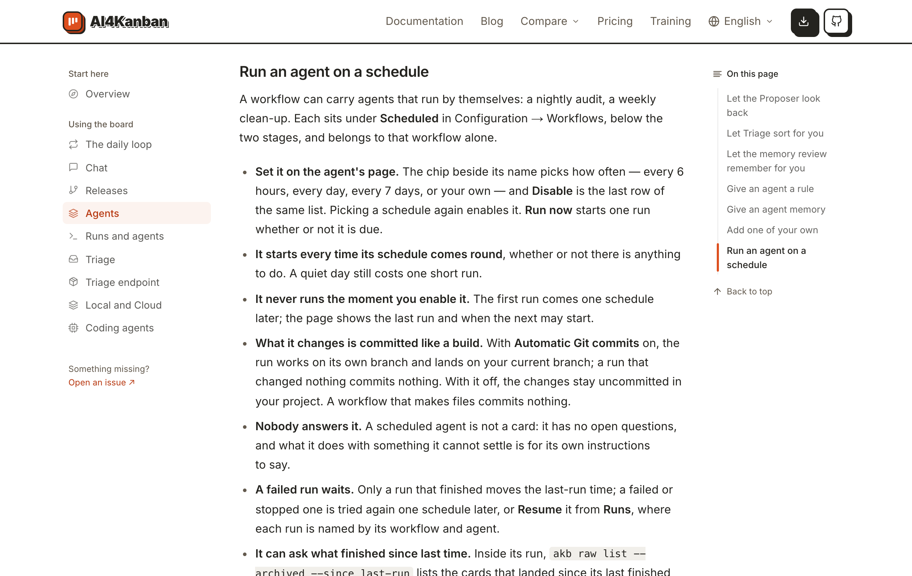

# 在文档里查怎么让一个 Agent 定期运行

## Setup

- **站点**：官网（`web/`）在本地跑起来，浏览器打开 `/docs/agents`，窗口宽 1280px。
- **读者**：想让某件重复的事（每晚检查、每周清理）自己跑起来、还没在看板里找到入口的人。

## Steps

1. 打开文档的「Configure your agents」页。
   开头一段说工作流的 Agent 在 **Configuration → Workflows**、全看板的在 **Configuration → Board**，每个 Agent 有自己的页面，周期 Agent 还有周期设置。右侧目录倒数第三项是「Run an agent on a schedule」。
   

2. 点目录里的「Run an agent on a schedule」。
   页面滚到这一节，目录里该项高亮。第一段：全看板的周期 Agent 在 **Configuration → Board**，工作流的在 **Configuration → Workflows** 的 **Scheduled** 下，「Coding includes QA manager」。第二段一口气讲完：**Auto**（有新输入时跑）、预设或自定义周期，**Disable** 关掉，**Run now** 停用时也能跑，开着 **Automatic Git commits** 时改动会提交，失败的稍后重试或在 **Runs** 里续跑。最后是三行命令：`akb workflow schedule <id> --on <agent> --cadence 1d`、`--off <agent>`、`--run <agent>`。
   

3. 点目录里的「Add one of your own」。
   两条路：让编程 Agent 读 `akb guide write-agent` 后新建；或在 **Configuration → Workflows** 点 **Helpers** 旁或 **Scheduled** 下的 **+**。一句区分 helper（参与规划）和 scheduled（不挂卡片自己跑）；末尾一句 **Delete** 删掉自己加的 Agent 及其规则和记忆。
   

> **证据环境**：main（01ddb6ac）上本地站点所有 `/docs` 页都是 500（见 [`read-the-agents-the-board-ships-in-the-docs`](../read-the-agents-the-board-ships-in-the-docs/case.md)，已报待筛选）。以上截图取自 `web/` 的临时副本，只把 `public/llms.txt` 里 Agents 那一行换成新描述。

## Feedback

- **更短了**：旧版四条要点并成一段，在哪设、怎么关、怎么手动跑、失败怎么办都在，和界面上的词（Scheduled、Auto、Disable、Run now、Runs）对得上。
- **一段塞太多**：五件事挤在一段长句里，不如旧版分条好扫；想找「失败了怎么办」得从头读。
- **Auto 说得更具体了**：「run when it has new input」比旧版「something new for it」清楚一点，但仍没说什么算新输入。
- **「Run now … even when disabled」仍待核实**：#1414 实测停用的 Agent 点 **Run now** 被拒绝（见 [`local-ui/set-a-workflow-agent-to-run-on-a-schedule`](../../local-ui/set-a-workflow-agent-to-run-on-a-schedule/case.md)），这次只读文档没有重跑。
- **命令少了 `auto`**：旧版写了 `--cadence` 也能填 `auto`，现在只给 `1d`。
- **没说花多少**：每一遍是真实的 agent 运行，页上没有一句提成本。
- **没有跑到的**：窄屏、站内搜索；`akb guide write-agent` 本身；真实部署后的页面。
