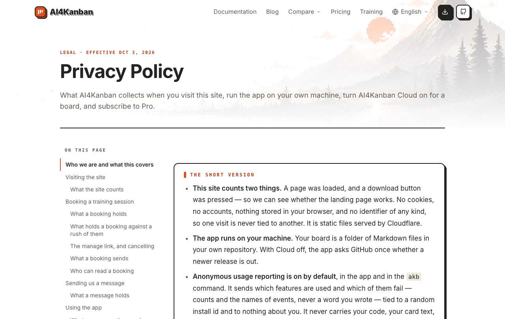

# 在隐私页查聊天回话会上报什么

## Setup

- **站点**：官网（`web/`）的静态构建用 `wrangler pages dev` 跑在本机（地址给 `SITE`），无头 Chrome 开远程调试（`CDP_PORT`），窗口 1280×1000；脚本是 [privacy.mjs](privacy.mjs)（用 [cdp.mjs](cdp.mjs) 驱动浏览器）。
- **读者**：开着用量上报、在看板上和 Agent 对话（建卡、规划、讨论）的人，想知道一次对话会往外发什么。

## Steps

1. 打开隐私页 `/privacy`。
   顶部是「LEGAL · EFFECTIVE OCT 16, 2026」和「Privacy Policy」，左侧「On this page」目录里「Using the app」下是「What usage reporting sends」「How long it is kept, and how to have it deleted」「Turning usage reporting off」三项，整个目录里没有「Feedback you send us」或「Partner feedback」。
    · [privacy.log](privacy.log)

2. 找页面里还提到反馈的地方。
   没有哪一节的标题提到反馈；只在「Data retention」里留了一条：「Partner feedback sent before the feature was removed — still kept.」，要删除就带着应用当时给的反馈编号发邮件到 support@ai4kanban.dev。
    · [privacy.log](privacy.log)

3. 点目录里的「What usage reporting sends」，再往下滚到事件表。
   页面跳到这一节（地址栏带 `#what-usage-reporting-sends`）。事件表里聊天那一行叫「A chat message was answered」，写明上报回话所用模型的名字（自定义端点或公开目录里没有的模型报 `custom`，与运行同一规则）和这次回话的估算花费（编码 Agent 给出时），并说不带消息、也不带回复。紧挨在上面的「A run started, finished, or failed」一行对运行写的是同样的模型和花费规则。整页不再出现「A chat message was sent」。
    · [privacy.log](privacy.log)

## Feedback

- **少了两节，说法更干净**：删掉反馈和合作反馈两节后，应用这部分只剩用量上报，「除了匿名统计什么都不收」读起来是真的；剩下那一条旧材料怎么删也写清了。
- **那一条放得偏**：旧的合作反馈只在「Data retention」的列表里提一句，提交过的人要从头翻到将近末尾才找得到，目录里也没有入口。
- **一眼能对上**：聊天行直接引用运行行的 `custom` 规则，上下两行挨着，读者不必去别处找定义。
- **花费的含义没说清**：「that reply's estimated cost」没写是这一轮自己的花费还是整个对话累计的，只有对照代码才知道是本轮。
- **难找**：这一节在一万多像素深的长页里，只能靠目录跳；跳过去后事件表还在下面将近一屏。
- **顶部「The short version」没提模型和花费**：只说「counts and the names of events, never a word you wrote」，只读摘要的人会以为上报里没有花费这类数值。
- **没有跑到的**：窄屏下的事件表、中文界面（隐私页只有英文版）。
