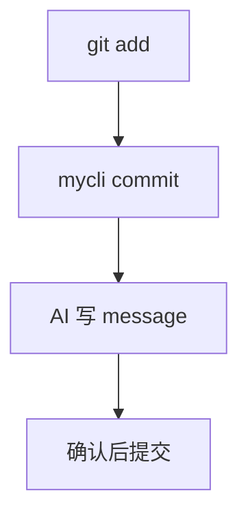

# AI 生成 commit message

`mycli commit` 读取暂存区的 diff，生成一条 commit message 供确认后提交；设置页可选模型和语言。



## 设置页长什么样

决定模型、语言两个选项的排布。

### A：单页表单

<Asset src=".assets/ai-commit-message/settings-form.tsx" label="设置页，单页表单" device="desktop" />

### B：分步向导

<Asset src=".assets/ai-commit-message/settings-wizard.html" label="设置页，分步向导" device="mobile" />

## 生成 commit message 的 Prompt

决定生成的格式和语气。

```text
You write one git commit message for the staged diff below.
- Subject: imperative mood, at most 50 characters, no trailing period.
- Body: only when the change needs a reason; wrap at 72 characters.
Return the message only.
```

输入：在 `parseArgs` 中新增 `--dry-run` 参数

```text
Add a --dry-run flag to parseArgs
```

## 选哪个模型 SDK

| Option | What it is | Pros | Cons |
| --- | --- | --- | --- |
| openai | 6.x, Apache-2.0 | 官方 | 只支持一家 |
| ai | 5.x, Apache-2.0 | 多家模型 | 多一层依赖 |

**Pick: ai** — 用户可换模型。

<!-- agent -->

## Decided by the agent

- **模型列表**：从现有 `models.json` 读取，不在设置页写死。
- **长 diff**：超过 8000 字符时只送文件名和改动统计。
- **生成失败**：退回手写，直接打开编辑器。
