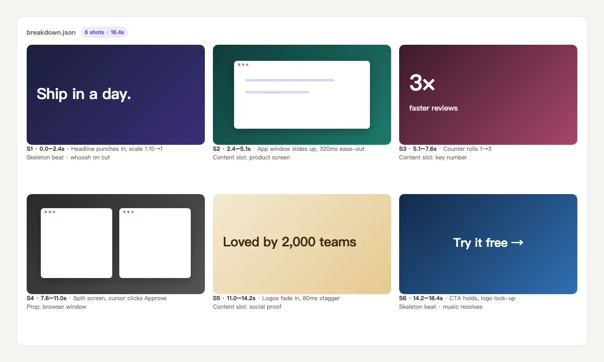
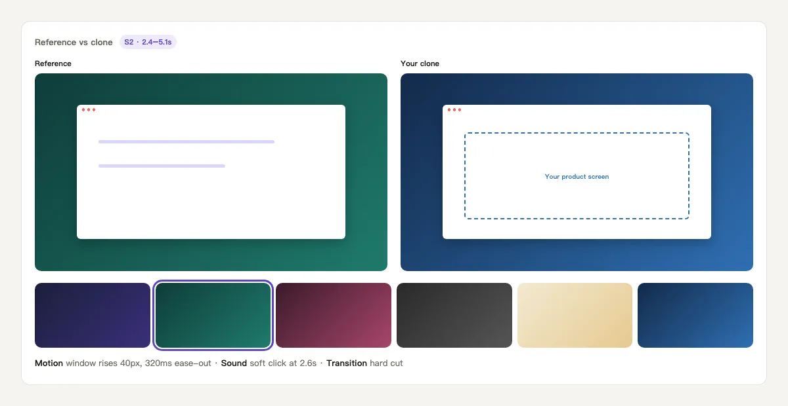

Give it a reference video. It breaks it down shot by shot — pacing, framing, motion, copy — and once you approve, turns it into a reusable template and renders the same structure with your own material. Made for copying what works in a short video, not its content.

